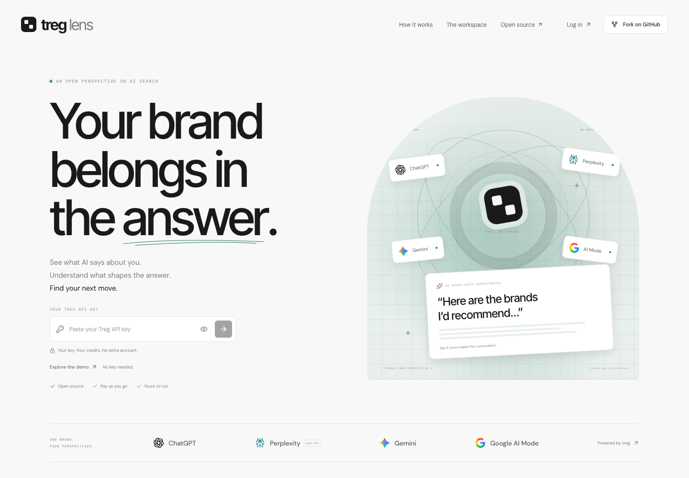
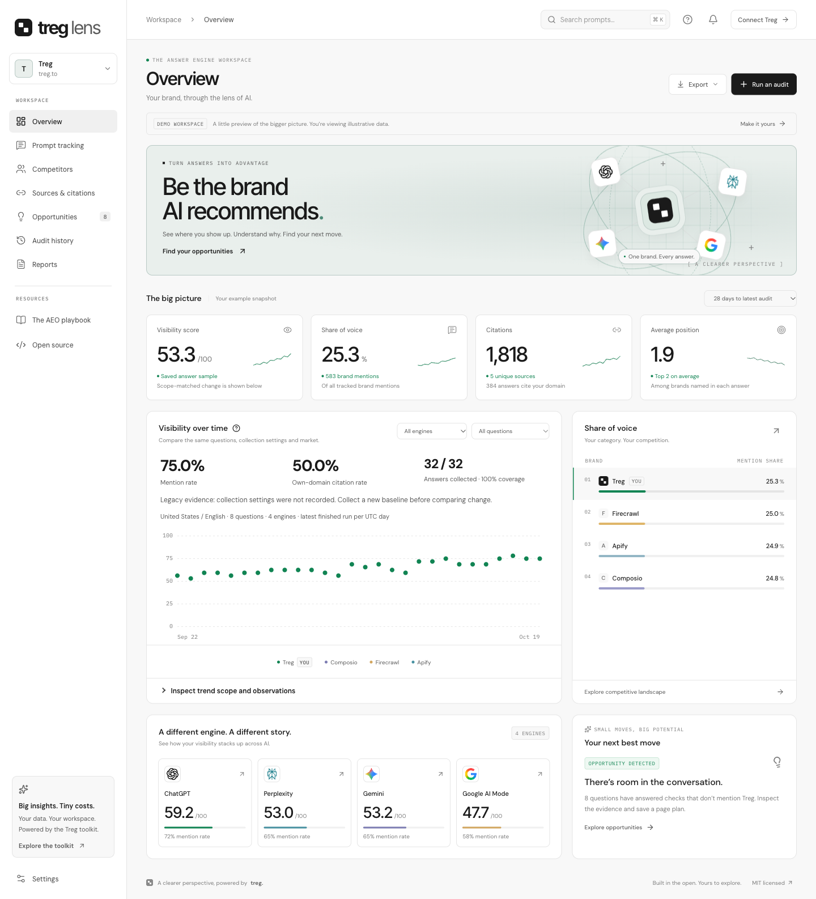

# Treg Lens

**See how AI sees your brand. Find your next move.**

[](https://github.com/tomcharlesosman/treg-lens/actions/workflows/test.yml)

A live, self-hosted AI visibility product powered by the [Treg AEO toolkit](https://treg.to/aeo). Connect your Treg key, discover buyer questions, collect answers, compare competitors, research citations, and track changes with budgeted daily or weekly audits. Private workspaces are saved on your server.

[**Open Treg Lens**](https://treg-lens-tom-osmans-projects.vercel.app) · [Fork the repository](https://github.com/tomcharlesosman/treg-lens/fork) · [Agent quickstart](docs/AGENT-QUICKSTART.md) · [Documentation](#documentation) · [MIT license](LICENSE)

[](https://vercel.com/new/clone?repository-url=https%3A%2F%2Fgithub.com%2Ftomcharlesosman%2Ftreg-lens%2Ftree%2Fmain&repository-name=treg-lens&project-name=treg-lens&products=%5B%7B%22type%22%3A%22integration%22%2C%22integrationSlug%22%3A%22neon%22%2C%22productSlug%22%3A%22neon%22%2C%22protocol%22%3A%22storage%22%7D%5D&env=SESSION_SECRET&envDescription=Create+a+private+random+SESSION_SECRET+of+at+least+32+characters+for+encrypted+sessions.+This+is+not+your+Treg+API+key.+See+the+linked+setup+guide.&envLink=https%3A%2F%2Fgithub.com%2Ftomcharlesosman%2Ftreg-lens%2Fblob%2Fmain%2Fdocs%2FDEPLOYMENT.md%23configuration-and-secrets)

The guided hosted path has four stages: create your repository, connect a Neon database, enter a private `SESSION_SECRET`, and deploy. Account sign-in, permissions, and provider terms can add screens. The build prepares the schema automatically; no SQL setup is needed. Visitors then enter their own Treg key. Manual research works on Vercel Hobby; optional minutely monitoring needs Pro and explicit configuration. See [hosted deployment](docs/DEPLOYMENT.md#guided-vercel-and-neon-deployment) or give an agent the [deployment prompt](docs/AGENT-QUICKSTART.md#copy-this-deployment-prompt).

## Run it

Install **Git and Node.js 24 LTS**; the minimum Node version is **22.13**. npm is included with Node. These commands work in macOS/Linux terminals and Windows PowerShell. After forking, use your fork's clone URL in the first command.

```bash
git clone https://github.com/tomcharlesosman/treg-lens.git
cd treg-lens
npm ci
npm run setup
npm run doctor
npm run dev
```

Open [localhost:3000/login](http://localhost:3000/login), paste your **team API key** from [Treg](https://treg.to/app), and open your private workspace. Configure your brand and start with one prompt and one engine. Review the live estimate before running your first audit. Sign-in validation is free, including with a zero-balance key.

You can install and verify the app without a Treg account. The optional [demo](http://localhost:3000/demo) is clearly labeled illustrative data; it is separate from live research.

`setup` creates private `.env.local` configuration using Node's built-in random generator. It creates a 64-character `SESSION_SECRET`, never prints it, and preserves a valid existing secret on repeated runs. Invalid nonempty secrets are refused rather than replaced. `doctor` checks local prerequisites without calling Treg. No copying environment files, OpenSSL, Docker, separately installed database, Redis, external identity service, or Treg SDK is required. The app uses Node's built-in SQLite support for durable workspace storage. Keep its data directory on persistent local disk.

The current lockfile has a documented, unpatched development-linter advisory. The production audit has no findings as of the verification date. Read [the audit notes](docs/DEPENDENCIES.md#audit-status) before following npm's force-fix suggestion.

No separate Lens account or operator `TREG_TOKEN` is needed. Paid discovery, manual audits, and source research start after you review an estimate and choose to run them. Automated audits require a separate, explicit monitoring configuration and budget.

Need a different port, setup help, or a complete first audit? Follow [getting started](docs/GETTING-STARTED.md). To hand setup to a coding agent, use the [copyable agent prompt](docs/AGENT-QUICKSTART.md#copy-this-prompt).

## What works today

- **Prompt discovery:** Google keyword suggestions and actual People Also Ask questions from 2–3 seed phrases; select up to 8 prompts to track.
- **Answer monitoring:** ChatGPT, Gemini, Google AI Mode, and Perplexity; up to 8 questions of 500 characters each across four engines.
- **Competitive visibility:** brand mentions, inferred recommendation positions, source coverage, trends, and share of voice from saved answers.
- **Cited-page research:** Moz authority metrics and Exa extraction with observed brand excerpts, authors, and contact routes.
- **Durable workspaces:** SQLite by default or hosted Neon Postgres, revision checks that protect concurrent changes, browser recovery, and JSON backup import/export.
- **Scheduled monitoring:** opt-in daily or weekly audits at a UTC hour, per-audit and monthly spending limits, worker status, and retained evidence after partial failures.
- **Action and history:** visibility gaps, writing-brief templates, completed moves, and JSON/CSV reports.
- **Your instance:** Treg-branded marketing, API-key login, a private workspace, and a separate labeled demo.

Perplexity uses the Sonar model API; the other engines return web-interface answers. Research uses United States / English parameters. Partial failures retain successful evidence, and missing fields stay unknown. The [architecture guide](docs/ARCHITECTURE.md#analytics-and-evidence) explains scoring and its limits.

Treg Lens is an independent implementation inspired by [Profound](https://www.tryprofound.com/). It does not promise complete Profound parity or provide shared team accounts, automatic outreach, or publishing. Content briefs currently provide editable writing templates; they are labeled as templates and do not make an additional model call.

## Documentation

| I want to… | Read |
| --- | --- |
| Install, connect a key, and run a first audit | [Getting started](docs/GETTING-STARTED.md) |
| Give setup or a fork to a coding agent | [Agent quickstart](docs/AGENT-QUICKSTART.md) and [AGENTS.md](AGENTS.md) |
| Deploy on Vercel + Neon or my own Node.js host | [Deployment](docs/DEPLOYMENT.md) |
| Understand the small dependency footprint | [Dependencies](docs/DEPENDENCIES.md) |
| Integrate with the HTTP API | [API contracts](docs/API.md) |
| Understand state, costs, and extension points | [Architecture](docs/ARCHITECTURE.md) and [product behavior](docs/PRODUCT-STATUS.md) |
| Run tests and inspect coverage | [Testing](docs/TESTING.md) and [verification report](docs/TEST-REPORT.md) |
| Contribute a fix or feature | [Contributing](CONTRIBUTING.md) and [pull request template](.github/pull_request_template.md) |
| Get help, report a bug, or report a vulnerability | [Support](SUPPORT.md), [security policy](SECURITY.md), and [code of conduct](CODE_OF_CONDUCT.md) |

## Costs, credentials, and data

Setup, the demo, and automated tests make no paid provider calls. Sign-in uses free Treg key metadata, and a valid zero-balance key can sign in. Estimates read the live catalog; paid work uses your Treg team's billing. Estimates are not final charges. Reported spend comes from Treg billing headers, and unknown charges stay distinct from zero. Check Treg activity after an ambiguous failure before deliberately retrying. See [API cost semantics](docs/API.md#costs-errors-and-retries).

Login sends your key to the application server and seals it into an encrypted HttpOnly cookie with a 12-hour lifetime. Production requires HTTPS and a stable private `SESSION_SECRET`. Protected access revalidates the key with Treg. Keys are excluded from `localStorage`, `sessionStorage`, and exports; optional per-request overrides stay in memory until reload. Public paid routes never inherit an operator's credential.

Project settings, prompts, audit history, completed moves, and source research are saved in the configured server database, separated by the verified key and stable deployment secret. Signing in with the same key on another browser reaches that instance's workspace. This is per-key access, not a team account or invitation system. Workspace content is ordinary database data; scheduled credentials receive separate authenticated encryption.

The local default is `data/treg-lens.sqlite`; no service is required. `DATABASE_URL` selects optional Postgres storage; Vercel requires it and fails closed without a durable database. Keep hosted configuration separate from your local `.env.local`. Back up the selected database safely and retain `SESSION_SECRET` separately. Secret rotation invalidates sessions, changes workspace namespaces, and prevents old scheduled credentials from being decrypted. See [deployment](docs/DEPLOYMENT.md) before changing it.

CSV and JSON reports contain the selected project and filters. Use **Backup and restore → Download full workspace backup** for an importable copy of every brand, date, engine, completed move, and source-research record. Filtered reports and demo exports cannot be restored as full workspaces. Export a full backup before replacing a workspace, resolving a concurrent-change conflict, changing keys, or performing a deployment migration. Browser recovery copies are useful safeguards, not a replacement for server backups. See [architecture](docs/ARCHITECTURE.md#browser-data-and-exports).

## Run scheduled monitoring

For a local/persistent host, start a separate worker while the application server is running:

```bash
npm run monitor
```

In your private workspace, choose daily or weekly monitoring, the UTC hour, prompts and engines, and spending limits. Enabling it explicitly allows the server to retain an encrypted copy of your signed-in key and run paid audits after your browser closes or you sign out. The worker refreshes catalog prices, reserves a ceiling before starting, and saves results to your workspace. The monthly limit covers automated monitoring, not manual audits or other activity in Treg.

On Vercel Pro, an operator can instead set `TREG_VERCEL_MONITORING=1` and a separate private `CRON_SECRET`, then redeploy to install the minutely dispatcher. Hosted forks omit cron by default so manual research can deploy on Hobby. Check the worker heartbeat in the app. Enabling a user schedule does not install or start a runner. Pausing removes the retained credential and prevents future runs; an already submitted provider request may still complete. Ambiguous billing, interrupted work, failed engines, or exhausted budgets pause monitoring for review, with uncertain reservations retained. Re-enabling is a deliberate action after checking Treg activity.

For a supervised production worker, a once-per-minute cron invocation, a custom app origin, and persistence requirements, follow [deployment](docs/DEPLOYMENT.md#monitoring-worker).

## Develop and verify

```bash
npm run check
```

This runs ESLint, fresh Next.js route type generation, TypeScript, library/setup tests, and local documentation-link checks. The project has **eight direct runtime packages**, including one driver for optional hosted Postgres; their roles are documented in [dependencies](docs/DEPENDENCIES.md). Local SQLite needs no service or database package of its own. Fonts are vendored locally, about **102 KB**, with licenses and provenance included. Builds and browsers do not download Google Fonts. See [font notices](src/app/fonts/README.md).

For the complete browser and HTTP suite, install the Playwright engines once and make OpenSSL available for the temporary HTTPS test certificate:

```bash
npx playwright install chromium firefox webkit
npm run doctor -- --e2e
npm run test:e2e
```

The suite builds the production app, runs it behind an isolated local HTTPS proxy, and replaces upstream Treg calls with fixtures that refuse unknown requests. It does not spend Treg credits. OpenSSL is only an end-to-end test prerequisite. `npm run test:e2e:ui` also builds first; `npm run test:e2e:report` opens the latest report. Linux may need Playwright's OS dependencies; follow the [testing guide](docs/TESTING.md) for platform details and the separate live-verification record.

## Make a fork yours

The [fork checklist](docs/AGENT-QUICKSTART.md#make-a-fork-yours) covers repository URLs, support/security destinations, metadata, branding, test expectations, and license notices. Enable private vulnerability reporting and security updates for your own GitHub repository; those settings are not inherited by cloning the code.

Contributions are welcome through [issues](https://github.com/tomcharlesosman/treg-lens/issues) and pull requests. Follow [CONTRIBUTING.md](CONTRIBUTING.md), report vulnerabilities through [SECURITY.md](SECURITY.md), and preserve the [MIT license](LICENSE) and [third-party notices](THIRD_PARTY_NOTICES.md).

## Preview





Treg Lens is released under the MIT license. Font licenses remain separate. Product names and trademarks belong to their respective owners; this project is not affiliated with Profound.
