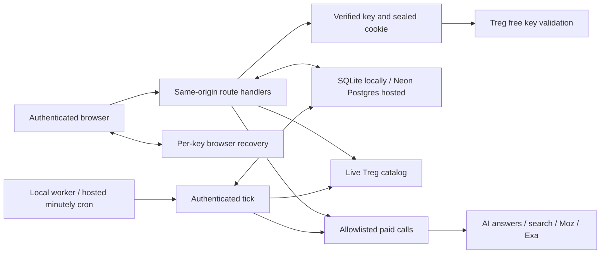

# Architecture

Treg Lens is a live Next.js application with durable workspaces, bounded Treg adapters, and optional paid monitoring. A user signs in with a verified Treg team key, runs research, and returns to the same server-side history from another browser. Follow [getting started](GETTING-STARTED.md) for first use and [deployment](DEPLOYMENT.md) for local SQLite or hosted Vercel + Neon.

The product discovers questions, measures AI answers, compares brands, researches cited pages, and records repeat audits. It includes backup import/export and budgeted daily or weekly monitoring. It does not provide managed team accounts, automatic publishing, outreach, or complete Profound parity. Writing briefs currently remain explicitly labeled templates.

## System map

Only the server sends credentials upstream. The database stores workspace snapshots and monitoring state. Private workspace content is not encrypted by the application; the separately retained monitoring key is encrypted with AES-256-GCM. Protect the host, database directory, backups, and application secret accordingly.

## Repository map

| Location | Responsibility |
| --- | --- |
| [`src/app`](../src/app) | Public pages, request-time session gate, and narrow HTTP routes |
| [`src/components/workspace.tsx`](../src/components/workspace.tsx) | Live workspace, recovery, navigation, metrics, imports and exports |
| [`src/lib/aeo.ts`](../src/lib/aeo.ts) | Audit input limits, live pricing, engine requests, normalization and billing |
| [`src/lib/discovery.ts`](../src/lib/discovery.ts) | Bounded keyword ideas and actual People Also Ask questions |
| [`src/lib/discovery-research.ts`](../src/lib/discovery-research.ts) | Contextual seed defaults, bounded discovery receipts and provenance validation |
| [`src/lib/prompt-library.ts`](../src/lib/prompt-library.ts), [`measurement.ts`](../src/lib/measurement.ts) | Stable question inventory, frozen collection scopes and comparable observations |
| [`src/lib/citation-analytics.ts`](../src/lib/citation-analytics.ts) | Page/domain aggregation, historical ownership and independent mention/citation evidence |
| [`src/lib/onboarding.ts`](../src/lib/onboarding.ts), [`brand-onboarding.tsx`](../src/components/brand-onboarding.tsx) | URL-led brand research, editable suggestions, and recoverable first-run setup |
| [`src/lib/source-research.ts`](../src/lib/source-research.ts) | Public-URL/DNS checks, Moz metrics and Exa page evidence |
| [`src/lib/treg-session.ts`](../src/lib/treg-session.ts), [`treg-auth.ts`](../src/lib/treg-auth.ts) | Encrypted sessions, key validation and credential ownership |
| [`src/lib/database.ts`](../src/lib/database.ts) | Private data path, built-in SQLite connection, WAL and database setup |
| [`src/lib/storage-database.ts`](../src/lib/storage-database.ts) | Shared asynchronous sessions, SQLite serialization, Postgres transactions and explicit schema migration |
| [`src/lib/workspace-uploads.ts`](../src/lib/workspace-uploads.ts) | Owner-bound chunk uploads, checksum validation and atomic final save |
| [`src/lib/workspace-repository.ts`](../src/lib/workspace-repository.ts) | Snapshot validation, revision compare-and-swap, atomic run append |
| [`src/lib/workspace-storage.ts`](../src/lib/workspace-storage.ts) | Versioned workspace shape and malformed-data rejection |
| [`src/lib/workspace-profile.ts`](../src/lib/workspace-profile.ts) | Browser-safe profile metadata limits, evidence links and receipt field projection |
| [`src/lib/monitoring.ts`](../src/lib/monitoring.ts) | Encrypted credentials, schedules, leases, reservations and settlement |
| [`scripts/monitor.mjs`](../scripts/monitor.mjs) | Authenticated periodic or once-only worker invocation |
| [`tests/e2e/support`](../tests/e2e/support) | Isolated HTTPS server and fail-closed synthetic provider boundary |

## Authentication and ownership

`/login` verifies the submitted key through a free authenticated Treg metadata request. A zero-balance team key can sign in. The server seals it into a 12-hour HttpOnly, SameSite=Lax cookie; production cookies are Secure. Protected routes revalidate the key, so an upstream revocation stops subsequent access and paid work. Optional manual request overrides are validated independently and stay in browser memory until reload. They never replace a schedule's retained signed-in credential.

Workspace identity is an opaque HMAC of the key and stable `SESSION_SECRET`. Clients cannot choose a different workspace ID in a persistence or monitoring request. The same key on the same deployment identifies the same workspace. A different key or secret identifies a different namespace. There is no invitation, role, membership, or shared-account authorization model; people who possess the same key share access to that key's workspace.

An operator `TREG_TOKEN` is never a fallback for a public paid route. Keys are excluded from snapshots, JSON/CSV reports, browser storage, logs, and public schedule responses. Enabling monitoring is the explicit exception to stateless credential retention: its encrypted key stays on the server until monitoring is paused or removed.

## Durable workspace and concurrency

New live workspaces start with an empty brand and no example questions. Guided setup collects a public website and optional target audience, shows the fixed United States / English measurement market, offers a free catalog estimate, then submits one explicitly approved `exa.web.answer` request through Treg. Reviewed buyer context informs that request; unsupported markets are rejected, without introducing unsupported provider parameters. Structured output provides a suggested brand description, competitors and generated buyer questions with cited sources and optional intent/reason metadata. These suggestions are not search-volume or People Also Ask observations; the separate discovery flow provides those. Returned text and links are untrusted, bounded, and sanitized.

Research never starts automatically. The route revalidates the caller, checks public DNS, refreshes fixed pricing, and refuses a price above the visitor's accepted maximum (hard limit $0.05). There is no direct page fetch, provider waterfall, automatic retry, or automatic audit. Manual setup needs no paid call. The UI keeps editable setup drafts and the research receipt in a per-workspace browser key; an interrupted in-flight marker warns before another paid request. Confirming setup writes brand, optional description/audience, competitor names/details, selected questions, reviewed question metadata, original receipts and `onboardingCompletedAt` through ordinary workspace revision checks. Audit review opens only after the save is acknowledged.

Canonical `competitors: string[]` and workspace `prompts: string[]` remain compatible with existing clients. Optional `competitorDetails` retains domains and reasons for those selected names. A generated competitor's `sourceUrl` is retained only if it occurs in the research citations and its hostname belongs to that competitor's domain or subdomain; absence means unverified, and citation provenance is not a guarantee that every claim is true. Identity edits clear stale UI evidence. Optional `buyerQuestions` keeps up to sixteen reviewed suggestions, including unselected ideas, labeled generated/manual/discovered; selected `prompts` alone control paid scope. Old provider output with only question strings remains valid.

Optional `researchReceipts` keeps the last five onboarding outcomes with their original URL, sources, questions, costs, call IDs and completion time. New receipts include a credential-free `input` record of the normalized submitted URL, optional reviewed audience and fixed market; this distinguishes original input from inferred profile suggestions. Receipts remain independent of current profile edits and survive switching the workspace's brand, so earlier paid evidence is inspectable. Same-brand settings/audit updates preserve optional business context; different-brand updates do not inherit that context. Receipts are field-projected to exclude nested credential fields and are validated on backup import. They become durable only after an acknowledged workspace save; the manual research HTTP request itself has no durable job queue. An interrupted request is never automatically repeated, and an unknown charge is never rewritten as zero.

Established workspaces with saved audits or customized profiles/questions bypass first-run setup. Untouched old Treg example workspaces are guided into setup. Optional profile fields preserve compatibility with older backups. Save failures keep the review open; stale revisions require explicit conflict recovery. No database migration or additional dependency is needed.

Established users can explicitly open **Settings → Rerun onboarding**. The authenticated `/app?setup=review` route selects a client review mode without clearing `onboardingCompletedAt`, changing credentials or resetting the server snapshot. Its draft has a separate per-workspace browser key and captures the starting revision. Back/reload resumes that draft; leaving does not apply its profile. Applying a review checks both the captured revision and ordinary server compare-and-swap, even if a periodic read has adopted a newer server revision. Explicitly reloading the saved profile rebases only after confirmation and keeps any new paid receipt or interruption marker. Valid legacy receipts keep their optional fields unchanged when restored.

Profile saves retain the current snapshot's audits, completed moves and source research. Rerun saves also retain every existing tracked question and add the reviewed selection; the immediate audit dialog uses only that selection. Monitoring is stored separately and is never changed by review. Workspace dialogs remain mounted while the main view is hidden/inert so a previously submitted audit or discovery response is still received. Profile reload refuses when workspace changes or upload acknowledgments are pending, preserving unsynced paid evidence for normal synchronization/backup recovery. No paid action starts on entry, return, reload or profile save. All research/audit approvals remain explicit.

Local forks default to `data/treg-lens.sqlite`, or `treg-lens.sqlite` inside `TREG_DATA_DIR`. Node provides built-in SQLite; no external service is needed. The directory has mode 0700 and files 0600 where supported; configure equivalent Windows ACLs. SQLite uses WAL, foreign keys, a five-second busy timeout, and serialized sessions on one persistent host.

`DATABASE_URL` selects optional Postgres, or choose explicitly with `TREG_STORAGE=postgres`. Local tests force `TREG_STORAGE=sqlite` so inherited remote credentials cannot select production. Vercel requires Postgres and fails closed without it. The one added driver, `@neondatabase/serverless`, uses request-scoped connections and transactions. Shared domain operations use the same storage-session interface and purpose-scoped transaction locks. There is no ORM.

Hosted schemas are prepared by `npm run db:migrate`; `vercel.ts` explicitly runs it before `npm run build`. Module imports and plain Next builds never migrate a remote database. The script prefers `DATABASE_URL_UNPOOLED` when supplied. Runtime connections remain server-only.

`GET /api/workspace` returns a snapshot with a revision. A browser saves with `PUT` and the revision it loaded. A transaction accepts the write only if that revision still matches. A stale write receives 409 plus the current server state. The user must refresh and review their unsaved changes; blindly attaching a newer revision to an older snapshot could erase another tab or scheduled run.

Successful manual audits and scheduled audits append through a separate atomic repository operation. Existing audit IDs are idempotent within that append, and an append increments the revision. A paid answer is not treated as safe to repeat when persistence fails: the manual response preserves the evidence with a storage warning so it can be exported. Reconcile the save before any new paid run.

Snapshots accept known project, prompt, run, completed-move, source-research and optional question-inventory/discovery-receipt fields. Unknown credential fields are stripped. Malformed data is refused, cached research is validated, and snapshots are capped at 8 MiB. Saves above 3 MiB use owner-bound manifests, chunks of at most 1 MiB, and SHA-256 verification before a final atomic revision-checked save. Drafts expire after 15 minutes; staged chunks use purpose-separated authenticated encryption and owner/upload/index associated data, with bounded completed-upload retention. Large workspace/recovery JSON responses stream; these transport measures accommodate Vercel limits without reducing the snapshot bound. Browser recovery does not replace durable server backups.

Paid discovery appends a bounded original receipt atomically before responding, without replacing concurrent profile edits. Up to 20 receipts retain submitted brand/domain/seeds, the fresh accepted quote, original candidates and providers, locale, call IDs, errors and settled/unknown/reserved cost fields. Append is idempotent by receipt ID. A storage failure returns the evidence with `saved:false`; importing questions is a later revision-checked workspace change and waits for acknowledgment. The browser retains returned recovery data until that acknowledgment, and a pending marker prevents automatic repeats after reload. None of these recovery operations repeats provider calls.

Optional `promptRecords` holds at most 512 stable question records with wording, intent, neutral/branded type, topic, provenance, pause/archive state and optional discovery/candidate references. Existing string-only snapshots remain readable; reconciliation derives compatible IDs from existing wording without claiming that historical collection metadata was captured. Wording edits archive the old record and create/restore a distinct wording identity. The compatibility `prompts` array represents active manual defaults; the eight-question limit applies to execution. Inventory changes do not rewrite separately consented monitoring configuration.

## Browser data and exports

The authenticated UI loads the server workspace and retains local recovery behavior for unsaved changes and older browser-only installations. Legacy data must be validated and kept in its original key namespace; it must never silently overwrite an existing server snapshot or migrate another key's data. A save can commit on the server although the tab closes or loses the response before reading it, which leaves unsaved browser data at the older revision. If that data equals the server snapshot after validation and credential stripping, the browser adopts the server revision as saved without writing again. Any difference keeps both versions as a conflict.

JSON reports preserve the selected project's filtered audit and source-research data; CSV contains filtered answer rows. The separate full-workspace backup includes every brand, date, engine, completed move, source-research record, question-inventory record and retained discovery receipt. A reviewed full-backup import replaces content, not sessions, encrypted schedule credentials, or permission to spend. The separate monitoring-recovery format merges retained audit IDs into the current workspace while preserving existing audits and settings. Filtered reports and demo exports are refused by both restore paths. Take a backup before replacing content, pruning history, or resolving a conflict. Import validation applies the same snapshot and size limits as ordinary writes. Exports contain research data, so treat them as private even though authentication fields are excluded.

SQLite backup is a separate operator responsibility. Copying the main file alone while WAL writes are active can omit committed data. Use `npm run backup -- /private/path/new.sqlite` for a WAL-consistent online backup, or stop the app and worker before copying the complete data directory. Retain the stable secret separately and protect any backup containing encrypted monitoring credentials. Before restarting a SQLite worker after restore, run the offline `npm run monitor -- --pause-all` command and reconcile charges since the backup. Both local scripts refuse Postgres mode before touching SQLite. Hosted operators use provider backups or `pg_dump` with a direct connection and the [remote restore procedure](DEPLOYMENT.md#hosted-postgres-backup-and-restore).

## Scheduled paid monitoring

A schedule is an explicit saved configuration: daily or weekly interval, UTC hour, 1–8 prompts, engines, per-audit ceiling, and monthly monitoring budget. First execution is the next chosen UTC hour. Subsequent successful executions preserve that UTC cadence, skipping missed slots rather than launching catch-up audits. A schedule does not start a worker. Persistent hosts run a separate worker or invoke it with `--once`. Hosted Pro deployments set `TREG_VERCEL_MONITORING=1` and an independent `CRON_SECRET` to register one minutely GET cron. Default hosted forks register no cron and support manual research on Hobby. The UI exposes the runner heartbeat.

The retained key uses AES-256-GCM with a fresh 12-byte nonce and workspace ID as authenticated associated data. Credential encryption and internal runner authentication derive different keys from `SESSION_SECRET`. Public responses never return ciphertext or plaintext keys. The runner's bearer token authorizes internal ticks; an ordinary user session or Treg API key does not.

Each tick claims at most one due schedule under an atomic global database lease. The lease lasts ten minutes, beyond the audit route's normal request duration. Transactions cover claim, reservation, and settlement; provider network calls happen outside the database transaction. The worker revalidates the retained key, reads current catalog prices, and atomically reserves that full ceiling against the workspace's UTC-calendar-month monitoring ledger before paid work. The audit executes that reserved quote with per-call caps and stable job-based idempotency keys.

Known final charges replace reservations. Any unknown final charge retains the full reservation, including an HTTP 202 acceptance whose billing header represents an unsettled reservation. Partial errors, uncertain billing, over-reservation billing, provider/authentication failures, or exhausted budgets pause the schedule for review. A stale running job without a completed journaled result is marked interrupted and retains its reservation. A completed journaled result that was not appended is retained for recovery, with its known charges preserved. Neither is automatically resubmitted. Budget reservations belong to the month in which the job was claimed; the next month does not erase the old accounting history.

Pausing removes the retained credential and prevents future runs. It cannot cancel work already submitted upstream. Signing out clears the browser session; it does not pause an enabled schedule. The monthly budget applies only to automated audits through this scheduler, not manual research or other Treg activity. Re-enabling after an ambiguous outcome is a deliberate decision after checking provider activity.

## Analytics and evidence

Visibility averages `50 × mentioned + 30 × mentioned / position + 20 × own-domain-cited` across successful answers. Failed engines are excluded. Position uses an explicit numbered recommendation when present, otherwise inferred first-mention order among configured brands. Brand recognition is heuristic; scores are not a factuality, sentiment, or endorsement judgment.

Share of voice divides the brand's mentions by all tracked-brand mentions. Competitor cards describe observed mention rates. Opportunities rank the proportion of answers missing the brand. Current content briefs provide editable templates grounded in those gaps, not generated factual articles.

New manual and scheduled audits freeze `measurement` metadata: stable question ID/wording/type, brand/domain, US/English market and each engine's collector/source kind/provider/default model label. Cohort comparison uses all of these fields. A changed scope is excluded from the latest cohort rather than pooled into a progress delta. Each question/engine cell contributes at most one nonblank answer; duplicates resolve to the latest completed answer and errors stay missing. The latest finished audit per UTC day represents that day, avoiding extra weight for repeated checks. Rates and change comparisons require at least 90% requested-answer coverage. Mention and own-domain citation rates are separate. Neutral/branded filters change the selected cohort explicitly. An inspectable table retains partial and excluded observations.

Legacy runs derive an inspectable scope from their original strings/results, but unrecorded collector metadata is labeled legacy and cannot authorize a change comparison. New routes record the collector identity; underlying web-interface and Sonar default model versions are unreported. Matching these route/default labels is not proof that a provider kept an identical model. Model changes cannot be detected beyond the metadata actually available.

Citation exploration aggregates safe canonical page URLs separately from hostnames. Fragments are removed; distinct paths/queries remain distinct. The URL hostname, not a provider-supplied `domain` label, controls ownership. Each answered check counts once per page or domain; per-engine and distinct-question counts remain available. The original answer and citations are retained for exact evidence drilldown, while unsafe navigation/research URLs are excluded. A domain with multiple pages requires choosing a page before research; filters and saved-answer reads perform no provider work.

New audits snapshot selected competitor names/domains from the matching saved project. Ownership uses only that run's brand domain and competitor snapshot, with exact hostname or subdomain matching. Missing competitor domains leave unmatched sources unknown; current settings cannot fill historical gaps. Mention rates and competitor-domain citation rates use separate numerators and the answered checks for each saved identity/domain configuration. A missing domain yields an unknown citation rate, not zero. Source citations never automatically create business competitors.

Perplexity uses the Sonar model API; the other engines provide web-interface answers. These can cite different sources. Research uses US / English parameters. Source metrics describe Moz link authority. Exa extraction can be incomplete or cached; missing fields stay null, and contact routes must actually occur in returned evidence. Nothing sends outreach or publishes content.

## Paid-call and rendering boundaries

The server allowlists provider URLs and endpoint IDs. Inputs, fan-out, prices, and request times are bounded. Estimates are free catalog reads; paid work requires a verified caller and explicit user action or an enabled budgeted schedule. Actual charges come from Treg billing headers, not arbitrary provider JSON. Unknown and zero remain distinct.

Source research accepts only public HTTP(S) URLs and checks DNS before requesting extraction. The server does not fetch arbitrary user pages itself. The provider controls its own resolution and redirects, so the preflight is not a guarantee about every downstream hop. Preserve that distinction when extending SSRF protection.

Untrusted answers use safe Markdown rendering: HTML is skipped, unsafe link schemes are removed, and remote image markup is not fetched. Preserve keyboard focus containment, restoration, and accessible dialog labels when changing workflows.

Manual HTTP guards remain process-local best-effort duplicate protection. Durable monitor leases and budgets in either database protect scheduled work; they do not create a shared global limiter for every route. A public hosted service needs suitable proxy trust, operations, and additional tenant/instance controls beyond the shared database.

## Keep the dependency footprint small

Eight runtime packages provide optional hosted Postgres plus Next/React rendering, iron-session cookies, icons, and safe Markdown with GFM. Native `fetch`, `node:sqlite`, Node crypto/fs, local SVG analytics, and CSS provide the remaining capabilities. No ORM, Redis, separate identity provider, Treg SDK, scheduler package, or agent framework is required. Licensed fonts are checked in and loaded locally. See [dependencies](DEPENDENCIES.md).

For changes, follow [AGENTS.md](../AGENTS.md), [API contracts](API.md), and [testing](TESTING.md). Add evidence for authentication, save conflicts, schedule budgets, crash recovery, backup restoration, and provider normalization before claiming a new behavior is verified.
