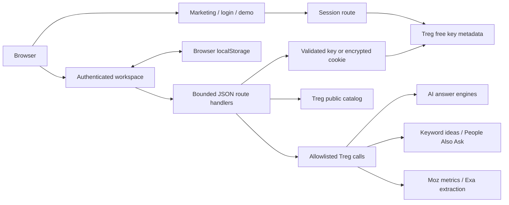

# Architecture

Treg Lens is one Next.js application with a browser-owned workspace and a small server-side Treg adapter. A fork needs no database, managed identity provider, worker service, or Treg SDK. Follow the [README](../README.md) for setup; this document explains the boundaries a contributor or coding agent needs before changing it.

The product is a focused self-hosted AI visibility workflow: discover questions, collect answers, inspect cited evidence, and prepare content briefs. It does not implement the entire Profound product, managed team accounts, scheduled tracking, publishing, or automatic outreach.

## System map



The browser submits requests to its own origin. Only the server uses Treg credentials upstream. Workspace persistence stays in the browser; HTTP routes return research results without writing a server-side project database.

## Repository map

| Location | Responsibility |
| --- | --- |
| [`src/app/page.tsx`](../src/app/page.tsx), [`src/app/login`](../src/app/login), [`src/app/demo`](../src/app/demo) | Public marketing, key sign-in and illustrative workspace |
| [`src/app/app/page.tsx`](../src/app/app/page.tsx) | Request-time session gate and keyed workspace mount |
| [`src/app/api`](../src/app/api) | Narrow HTTP methods, bounded JSON parsing, credential ownership and process-local guards |
| [`src/components/workspace.tsx`](../src/components/workspace.tsx) | Project state, navigation, charts, filters, prompts, history, briefs and exports |
| [`src/components/key-sign-in-form.tsx`](../src/components/key-sign-in-form.tsx) | Hydration-ready input, key verification, session-ready state and account switching |
| [`src/components/audit-dialog.tsx`](../src/components/audit-dialog.tsx) | Audit workflow and shared `DialogFrame` focus primitive |
| [`src/components/discovery-dialog.tsx`](../src/components/discovery-dialog.tsx), [`source-dialog.tsx`](../src/components/source-dialog.tsx), [`settings-dialog.tsx`](../src/components/settings-dialog.tsx) | Discovery, cited-page research and project configuration |
| [`src/lib/aeo.ts`](../src/lib/aeo.ts) | Audit validation, pricing, provider allowlist, normalization, domain and origin helpers |
| [`src/lib/discovery.ts`](../src/lib/discovery.ts) | Bounded keyword/PAA pipeline, provider selection and charge accounting |
| [`src/lib/source-research.ts`](../src/lib/source-research.ts) | URL/DNS checks, Moz/Exa calls and observed page evidence |
| [`src/lib/treg-session.ts`](../src/lib/treg-session.ts), [`treg-auth.ts`](../src/lib/treg-auth.ts) | Pure session/key primitives and the server-only Next.js cookie bridge |
| [`src/lib/workspace-data.ts`](../src/lib/workspace-data.ts), [`workspace-storage.ts`](../src/lib/workspace-storage.ts) | Analytics, deterministic demo data, exports and stored-snapshot validation |
| [`src/components/answer-body.tsx`](../src/components/answer-body.tsx) | Safe Markdown display for untrusted engine answers |
| [`src/lib/site.ts`](../src/lib/site.ts) | Repository and fork URLs used by the UI |
| [`src/app/globals.css`](../src/app/globals.css), [`src/components/marketing.css`](../src/components/marketing.css) | Workspace and marketing visual system; dialog styles sit beside their components |
| [`src/app/fonts`](../src/app/fonts/README.md) | Vendored font files, licenses and recorded upstream provenance |
| [`scripts`](../scripts) | Dependency-free local setup, prerequisite checks and documentation-link checks |
| [`tests/e2e`](../tests/e2e), `src/lib/*.test.ts` | Browser/HTTP workflows and pure-function tests |

Next.js Cache Components and partial prefetching are enabled in [`next.config.ts`](../next.config.ts). `/app` calls `connection()` before time-sensitive session work and places it behind `Suspense`, so credentials are checked after the actual request arrives. Its `Workspace` is keyed by opaque workspace ID; switching keys remounts local state. Read the installed `node_modules/next/dist/docs/` guidance described in [`AGENTS.md`](../AGENTS.md) before changing framework APIs.

## Sign-in and credential ownership

1. The user enters a Treg team API key. The client form stays disabled until hydration is ready. A late background session lookup cannot overwrite an explicit key-entry attempt.
2. Session POST reads bounded JSON, checks the request's Origin host when present, validates the key's syntax, and calls Treg's free key metadata endpoint.
3. `iron-session` seals `{ token, workspaceId, issuedAt, expiresAt }` using the private deployment secret. Only `{ authenticated, workspaceId }` is returned in JSON. The cookie is HttpOnly, SameSite=Lax, production-Secure, and expires after 12 hours.
4. `/app`, session/status reads, and cookie-authenticated paid requests decrypt and revalidate the key. Revoked keys fail authentication; upstream validation failure fails closed.
5. Paid API clients may instead send their own explicit `token` in the JSON body. That key is validated independently and takes precedence over any session.

The browser sends the key to the application server as a plaintext JSON field over HTTPS. Cookie encryption protects its stored representation; it does not make the key invisible to the deployment operator. Keep credentials out of request logs, analytics and exported application data.

The UI's optional credential override lives in React memory only. It is not written into snapshots or exports and disappears on reload. The session key remains HttpOnly. A compatibility cleanup removes the old `sessionStorage` token key rather than restoring it.

Public paid routes always run `authorizePaidInput()` before lower-level adapters. Although `resolveCredentials()` supports `TREG_TOKEN`/`TREG_ORG` for direct server-library use, public HTTP requests receive an explicitly owned, verified key and never use that fallback. Preserve this ordering when adding an endpoint.

## Research request lifecycle

1. The browser validates the form and requests a free live quote. UI quote state is tied to the exact request, so edits invalidate stale estimates. Paid buttons stay disabled until the current estimate is available.
2. A deliberate action submits the paid request. The route parses and bounds it, resolves caller credentials, and applies its local guard. Source research also checks public DNS.
3. The adapter refreshes catalog pricing. Missing, changed or out-of-range prices fail before provider calls. Each upstream call gets an idempotency UUID, a catalog-derived maximum cost and a feature metadata tag.
4. Native `fetch` calls only fixed `https://treg.to/catalog/...` or `https://treg.to/call/...` routes. Provider inputs, locale, timeouts and call counts are constructed server-side. There is no arbitrary URL/endpoint proxy.
5. Normalizers retain successful evidence and return sanitized per-call errors. A successful HTTP response may contain partial results or only errors. Billing headers supply settled spend; absent charges remain unknown.
6. The browser merges completed audit/source results into local state, then persists the snapshot. Discovery candidates enter the tracked prompt list only after selection and import.

Audit execution uses up to 12 concurrent workers across at most 8 prompts and 4 engines. Discovery runs 2–3 bounded keyword requests followed by at most 3 PAA lookups. Source research runs one metrics lookup and one extraction. See [API limits and contracts](./API.md) for exact fields, ceilings and durations.

Audit and discovery components remain mounted when their dialogs close. Their in-flight request and result state therefore survive closing and reopening within the same workspace tab. This is a client lifecycle feature, not a durable background worker. Closing/reloading the page or remounting the workspace can lose a result while upstream work or billing continues. There is no polling, server history, automatic retry, scheduler, or recovery queue. Source research is a separate conditional component and should not be assumed to share the same close/reopen lifecycle.

## Provider boundaries and costs

| Workflow | Selected upstream behavior |
| --- | --- |
| ChatGPT / Gemini / Google AI Mode | Fixed Cloro endpoints returning web-interface answers |
| Perplexity | Routed Sonar model API; Cloro excluded; current quote uses the DataForSEO child catalog price |
| Keyword ideas | Treg route pinned to AnyAPI with waterfall disabled and other advertised providers excluded |
| People Also Ask | Cloro organic search endpoint, preserving actual `peopleAlsoAsk` fields |
| URL authority | Treg metrics route pinned to Moz with waterfall disabled |
| Page content | One native Exa request, one URL, bounded text with title/author metadata |

Provider selection and response shapes belong in adapters, not UI event handlers. Search questions are observed PAA records, not model-generated replacements. Missing volumes or source fields remain nullable. Catalog data, Treg billing headers and provider responses have separate roles; [API cost semantics](./API.md#costs-errors-and-retries) documents their distinctions.

The requests sent upstream contain the work required for each tool: answer prompts, keyword seeds/queries, or the cited URL. Brand dictionaries are used locally to interpret answers and page text unless the user includes those names in their submitted prompts or seeds.

## Browser data and exports

An authenticated workspace stores this snapshot at `treg-lens-workspace-v1:<workspaceId>`:

```ts
type WorkspaceSnapshot = {
  project: { brand: string; domain: string; competitors: string[] };
  prompts: string[];
  runs: SavedRun[];
  done: string[];
  sourceResearch: Record<string, SourceResearch>;
};
```

`workspaceId` is an HMAC-derived namespace for one API key and one deployment secret. Two keys from the same Treg team still have separate namespaces. A secret rotation also creates a new namespace; old browser data is left in place rather than automatically migrated. Logout clears the session cookie but keeps local history.

Namespaces separate what the application loads; they are not encrypted storage or an authorization boundary between people sharing a browser profile. All research snapshots are ordinary origin-local browser data. There is no synchronization, database, managed backup, collaboration, or server export API. Clearing site data or changing browser/device loses access unless the user has exported a copy.

`parseWorkspaceSnapshot()` checks nested structures, finite numeric values and dates before loading. Invalid core snapshots fall back to defaults; invalid optional source entries are dropped. Storage failures leave the current in-memory workspace usable and show an export reminder. Legacy unscoped snapshots are not migrated into a signed-in namespace. Demo mode uses deterministic illustrative data, ignores saved private workspaces and never persists its edits.

Exports are created in the browser:

- CSV includes the currently filtered successful answer rows and escapes cells that could be interpreted as spreadsheet formulas.
- JSON includes version, project, tracked prompts, date/engine filter metadata, date-filtered runs, and source research for the current brand. Runs retain their full engine results; the selected engine is recorded as metadata rather than trimming those runs.
- Neither export contains the API key. JSON export is a portable report; there is currently no supported import/restore workflow.

## Analytics and evidence

Pure functions in [`workspace-data.ts`](../src/lib/workspace-data.ts) calculate metrics from successful saved answers. Failed answers are excluded from denominators. The toolkit visibility score averages 50 points for a brand mention, `30 / position` for its inferred rank, and 20 for an own-domain citation. The competitor chart compares mention rates; share of voice divides own mentions by mentions of tracked brands. Citation coverage counts distinct successful answers citing each domain.

The prompt/engine/date filters operate on local saved data. Date ranges anchor to the latest saved audit, not a presumed daily sampling schedule. Opportunity and brief features summarize observed missing mentions; content briefs are local templates, not additional model calls. The score is a prioritization heuristic, not a guaranteed recommendation or causal measurement. Keep these definitions and the [analytics tests](../src/lib/workspace-data.test.ts) in sync when changing denominators or labels.

Engine answers and extracted content are untrusted. `AnswerBody` renders Markdown with raw HTML skipped, HTTP(S)-only links and remote images omitted. Contact routes come from returned content and metadata; they are not verified people records. Missing evidence remains unknown.

## Environment boundaries

| Variable | Role | Browser exposure |
| --- | --- | --- |
| `SESSION_SECRET` | Required for browser sign-in/session decryption; private stable value, at least 32 characters | Never use a `NEXT_PUBLIC_` prefix or serialize it into props |
| `TREG_TOKEN` | Optional fallback for direct private server-library calls; unused by authenticated public HTTP flows | Never expose it; it is not required for normal setup |
| `TREG_ORG` | Optional organization only for that server-library fallback; never attached to a visitor's key | Never expose it |
| `NODE_ENV` | Framework mode; production forces Secure session cookies | Framework-managed |

The app requires a Node.js server: session HMAC/encryption and source DNS checks use Node primitives, and paid routes are not a static export. The supported engine is in [`package.json`](../package.json). Production needs HTTPS, a stable secret and a host whose request duration supports the chosen workflow. Application fonts are checked in and loaded with `next/font/local`; builds and browsers do not need Google Fonts requests. Their licenses and hashes live with the [font provenance](../src/app/fonts/README.md).

`npm run setup` uses Node's built-in cryptographic random generator to configure a secret without printing it, creating a new `.env.local` with mode `0600` and preserving an existing non-empty secret. `npm run doctor` checks local prerequisites without calling Treg. These scripts add no runtime package or hosted dependency; use the [README](../README.md) for their setup sequence and options.

## Security and operational limits

Request bodies are bounded, provider routes allowlisted, credential ownership checked, and upstream errors sanitized. Source URLs pass syntax/IP restrictions and an all-addresses-public DNS preflight. Lens delegates the actual page download to Treg providers; it cannot pin their DNS/redirect behavior. See the [SSRF contract](./API.md#public-url-and-ssrf-boundary).

Current rate guards are process-local and use the first forwarded address. They are best-effort protection against accidental duplicate work, not durable tenant quotas. Reverse proxies must overwrite client-supplied forwarded headers. A public multi-instance deployment needs shared atomic enforcement, observability and its own operational policies. There is no global audit ledger or cross-instance job coordination.

There is no automatic recovery after an ambiguous timeout. Call IDs and known charges help reconcile against Treg activity; a new click can create a new charge. Closing a session does not revoke the upstream credential. Keep these limits explicit in any hosted offering.

## Dependency choices

The runtime has seven direct packages, including the three framework/rendering packages. Their exact versions and transitive dependencies are recorded in the lockfile.

| Package | Reason it exists |
| --- | --- |
| `next`, `react`, `react-dom` | App Router, server/client rendering, route handlers and browser state |
| `iron-session` | Maintained encrypted/stateless cookie sealing instead of custom cryptography |
| `lucide-react` | Consistent SVG icons without a full component framework |
| `react-markdown` | Markdown parsing/rendering without injecting answer HTML |
| `remark-gfm` | Tables and other supported GitHub-flavored Markdown constructs |

Treg integrations use native `fetch`; analytics/charts use local functions and SVG; styling uses CSS; unit tests use Node's runner through `tsx`; E2E tests use Playwright. No ORM, chart framework, payment SDK, agent framework, Treg SDK or separate identity service is required. Add a dependency when its maintained capability justifies its install/build/runtime cost, then include the lockfile change and a focused test.

## Safe extension points

| Change | Where to start | Preserve |
| --- | --- | --- |
| Add an answer engine | `Engine`/`ENDPOINTS`/`providerBody`/`normalizeAnswer` in `aeo.ts`, UI engine list, stored-snapshot validator | Catalog verification, bounded input, locale, explicit source kind, unknown billing, tests |
| Add a discovery stage | `discovery.ts` types, quote and bounded pipeline | Real provenance, maximum call count, pinned provider behavior, partial results and nullable volumes |
| Add source evidence | `source-research.ts` plans and parsers | Public URL/DNS gate, single-page bounds, observed fields and nulls, charge accounting |
| Add a paid endpoint | A narrow route plus a testable adapter | Parse → authorize owned key → guard → price check → execute; never operator-token fallback |
| Change persistence | `workspace-storage.ts`, workspace key/remount and exports | No credentials in storage, malformed-data handling, explicit migration/backups and namespace isolation |
| Add scheduling/shared accounts | A separately designed durable storage/job/identity boundary | User ownership, shared atomic limits, reconciliation, retention and recovery semantics |
| Change dialogs/forms | Shared `DialogFrame`, native modal wrapper and key form | Keyboard trap/restoration, hydration readiness, preserving deliberate user input and focus |

Tests inject a fetch implementation at adapter boundaries. E2E runs the actual production app behind a local HTTPS proxy while a test-only preload intercepts the fixed Treg origin and refuses unknown requests. Keep that fixture out of production startup. New providers need normalization, spend-guard, partial-error and browser-flow coverage; see [CONTRIBUTING](../CONTRIBUTING.md), [testing](./TESTING.md) and the dated [verification report](./TEST-REPORT.md).
