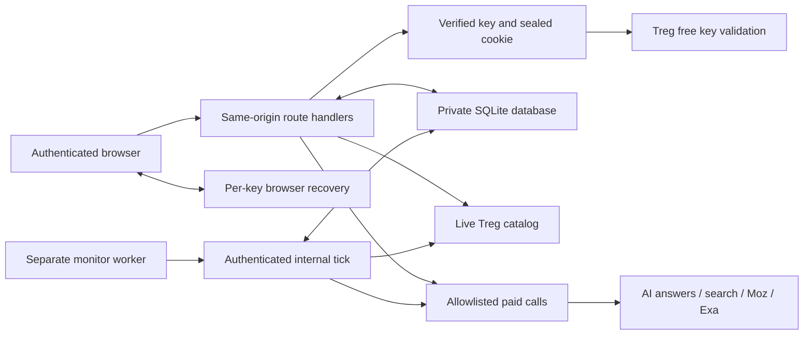

# Architecture

Treg Lens is a live Next.js application with a durable SQLite workspace, bounded Treg adapters, and an optional paid-monitoring worker. A user signs in with a verified Treg team key, runs research, and returns to the same server-side history from another browser. Follow [getting started](GETTING-STARTED.md) for first use and [deployment](DEPLOYMENT.md) for a persistent production host.

The product discovers questions, measures AI answers, compares brands, researches cited pages, and records repeat audits. It includes backup import/export and budgeted daily or weekly monitoring. It does not provide managed team accounts, automatic publishing, outreach, or complete Profound parity. Writing briefs currently remain explicitly labeled templates.

## System map

Only the server sends credentials upstream. The database stores workspace snapshots and monitoring state. Private workspace content is not encrypted by the application; the separately retained monitoring key is encrypted with AES-256-GCM. Protect the host, database directory, backups, and application secret accordingly.

## Repository map

| Location | Responsibility |
| --- | --- |
| [`src/app`](../src/app) | Public pages, request-time session gate, and narrow HTTP routes |
| [`src/components/workspace.tsx`](../src/components/workspace.tsx) | Live workspace, recovery, navigation, metrics, imports and exports |
| [`src/lib/aeo.ts`](../src/lib/aeo.ts) | Audit input limits, live pricing, engine requests, normalization and billing |
| [`src/lib/discovery.ts`](../src/lib/discovery.ts) | Bounded keyword ideas and actual People Also Ask questions |
| [`src/lib/source-research.ts`](../src/lib/source-research.ts) | Public-URL/DNS checks, Moz metrics and Exa page evidence |
| [`src/lib/treg-session.ts`](../src/lib/treg-session.ts), [`treg-auth.ts`](../src/lib/treg-auth.ts) | Encrypted sessions, key validation and credential ownership |
| [`src/lib/database.ts`](../src/lib/database.ts) | Private data path, built-in SQLite connection, WAL and database setup |
| [`src/lib/workspace-repository.ts`](../src/lib/workspace-repository.ts) | Snapshot validation, revision compare-and-swap, atomic run append |
| [`src/lib/workspace-storage.ts`](../src/lib/workspace-storage.ts) | Versioned workspace shape and malformed-data rejection |
| [`src/lib/monitoring.ts`](../src/lib/monitoring.ts) | Encrypted credentials, schedules, leases, reservations and settlement |
| [`scripts/monitor.mjs`](../scripts/monitor.mjs) | Authenticated periodic or once-only worker invocation |
| [`tests/e2e/support`](../tests/e2e/support) | Isolated HTTPS server and fail-closed synthetic provider boundary |

## Authentication and ownership

`/login` verifies the submitted key through a free authenticated Treg metadata request. A zero-balance team key can sign in. The server seals it into a 12-hour HttpOnly, SameSite=Lax cookie; production cookies are Secure. Protected routes revalidate the key, so an upstream revocation stops subsequent access and paid work. Optional manual request overrides are validated independently and stay in browser memory until reload. They never replace a schedule's retained signed-in credential.

Workspace identity is an opaque HMAC of the key and stable `SESSION_SECRET`. Clients cannot choose a different workspace ID in a persistence or monitoring request. The same key on the same deployment identifies the same workspace. A different key or secret identifies a different namespace. There is no invitation, role, membership, or shared-account authorization model; people who possess the same key share access to that key's workspace.

An operator `TREG_TOKEN` is never a fallback for a public paid route. Keys are excluded from snapshots, JSON/CSV reports, browser storage, logs, and public schedule responses. Enabling monitoring is the explicit exception to stateless credential retention: its encrypted key stays on the server until monitoring is paused or removed.

## Durable workspace and concurrency

The database defaults to `data/treg-lens.sqlite`, or `treg-lens.sqlite` inside `TREG_DATA_DIR`. It uses Node's built-in `node:sqlite`, no ORM or database package. The local directory is created with mode 0700 and files with 0600 where supported; configure equivalent Windows ACLs. SQLite uses WAL, foreign keys, and a five-second busy timeout. Use a persistent local filesystem on one deployment host; ephemeral serverless storage and unrelated replicas are not supported persistence arrangements.

`GET /api/workspace` returns a snapshot with a revision. A browser saves with `PUT` and the revision it loaded. A transaction accepts the write only if that revision still matches. A stale write receives 409 plus the current server state. The user must refresh and review their unsaved changes; blindly attaching a newer revision to an older snapshot could erase another tab or scheduled run.

Successful manual audits and scheduled audits append through a separate atomic repository operation. Existing audit IDs are idempotent within that append, and an append increments the revision. A paid answer is not treated as safe to repeat when persistence fails: the manual response preserves the evidence with a storage warning so it can be exported. Reconcile the save before any new paid run.

Snapshots accept known project, prompt, run, completed-move, and source-research fields. Unknown credential fields are stripped. Malformed data is refused, cached research is validated, and workspace request bodies are capped at 8 MiB. Browser recovery does not replace durable server backups.

## Browser data and exports

The authenticated UI loads the server workspace and retains local recovery behavior for unsaved changes and older browser-only installations. Legacy data must be validated and kept in its original key namespace; it must never silently overwrite an existing server snapshot or migrate another key's data.

JSON reports preserve the selected project's filtered audit and source-research data; CSV contains filtered answer rows. The separate full-workspace backup includes every brand, date, engine, completed move, and source-research record. A reviewed full-backup import replaces content, not sessions, encrypted schedule credentials, or permission to spend. The separate monitoring-recovery format merges retained audit IDs into the current workspace while preserving existing audits and settings. Filtered reports and demo exports are refused by both restore paths. Take a backup before replacing content, pruning history, or resolving a conflict. Import validation applies the same snapshot and size limits as ordinary writes. Exports contain research data, so treat them as private even though authentication fields are excluded.

SQLite backup is a separate operator responsibility. Copying the main file alone while WAL writes are active can omit committed data. Use `npm run backup -- /private/path/new.sqlite` for a WAL-consistent online backup, or stop the app and worker before copying the complete data directory. Retain the stable secret separately and protect any backup containing encrypted monitoring credentials. Before restarting a worker after database restore, run the offline `npm run monitor -- --pause-all` command and reconcile charges since the backup.

## Scheduled paid monitoring

A schedule is an explicit saved configuration: daily or weekly interval, UTC hour, 1–8 prompts, engines, per-audit ceiling, and monthly monitoring budget. First execution is the next chosen UTC hour. Subsequent successful executions preserve that UTC cadence, skipping missed slots rather than launching catch-up audits. A schedule does not start a worker. Run the separate worker process, or invoke it with `--once` from a scheduler. The UI exposes its last heartbeat.

The retained key uses AES-256-GCM with a fresh 12-byte nonce and workspace ID as authenticated associated data. Credential encryption and internal runner authentication derive different keys from `SESSION_SECRET`. Public responses never return ciphertext or plaintext keys. The runner's bearer token authorizes internal ticks; an ordinary user session or Treg API key does not.

Each tick claims at most one due schedule under an atomic global SQLite lease. The lease lasts ten minutes, beyond the audit route's normal request duration. Transactions cover claim, reservation, and settlement; provider network calls happen outside the database transaction. The worker revalidates the retained key, reads current catalog prices, and atomically reserves that full ceiling against the workspace's UTC-calendar-month monitoring ledger before paid work. The audit executes that reserved quote with per-call caps and stable job-based idempotency keys.

Known final charges replace reservations. Any unknown final charge retains the full reservation, including an HTTP 202 acceptance whose billing header represents an unsettled reservation. Partial errors, uncertain billing, over-reservation billing, provider/authentication failures, or exhausted budgets pause the schedule for review. A stale running job without a completed journaled result is marked interrupted and retains its reservation. A completed journaled result that was not appended is retained for recovery, with its known charges preserved. Neither is automatically resubmitted. Budget reservations belong to the month in which the job was claimed; the next month does not erase the old accounting history.

Pausing removes the retained credential and prevents future runs. It cannot cancel work already submitted upstream. Signing out clears the browser session; it does not pause an enabled schedule. The monthly budget applies only to automated audits through this scheduler, not manual research or other Treg activity. Re-enabling after an ambiguous outcome is a deliberate decision after checking provider activity.

## Analytics and evidence

Visibility averages `50 × mentioned + 30 × mentioned / position + 20 × own-domain-cited` across successful answers. Failed engines are excluded. Position uses an explicit numbered recommendation when present, otherwise inferred first-mention order among configured brands. Brand recognition is heuristic; scores are not a factuality, sentiment, or endorsement judgment.

Share of voice divides the brand's mentions by all tracked-brand mentions. Competitor cards and the trend compare actual mention rates. Source coverage counts successful answers citing a domain, not raw repeated citation links. Opportunities rank the proportion of answers missing the brand. Current content briefs provide editable templates grounded in those gaps, not generated factual articles.

Perplexity uses the Sonar model API; the other engines provide web-interface answers. These can cite different sources. Research uses US / English parameters. Source metrics describe Moz link authority. Exa extraction can be incomplete or cached; missing fields stay null, and contact routes must actually occur in returned evidence. Nothing sends outreach or publishes content.

## Paid-call and rendering boundaries

The server allowlists provider URLs and endpoint IDs. Inputs, fan-out, prices, and request times are bounded. Estimates are free catalog reads; paid work requires a verified caller and explicit user action or an enabled budgeted schedule. Actual charges come from Treg billing headers, not arbitrary provider JSON. Unknown and zero remain distinct.

Source research accepts only public HTTP(S) URLs and checks DNS before requesting extraction. The server does not fetch arbitrary user pages itself. The provider controls its own resolution and redirects, so the preflight is not a guarantee about every downstream hop. Preserve that distinction when extending SSRF protection.

Untrusted answers use safe Markdown rendering: HTML is skipped, unsafe link schemes are removed, and remote image markup is not fetched. Preserve keyboard focus containment, restoration, and accessible dialog labels when changing workflows.

Manual HTTP guards remain process-local best-effort duplicate protection. Durable monitor leases and budgets protect scheduled work; they do not create a shared global limiter for every route. A public hosted service needs suitable proxy trust, operations, and additional tenant/instance controls beyond this single-host design.

## Keep the dependency footprint small

The seven runtime packages provide Next/React rendering, iron-session cookies, icons, and safe Markdown with GFM. Native `fetch`, `node:sqlite`, Node crypto/fs, local SVG analytics, and CSS provide the remaining capabilities. No ORM, Redis, separate identity provider, Treg SDK, scheduler package, or agent framework is required. Licensed fonts are checked in and loaded locally. See [dependencies](DEPENDENCIES.md).

For changes, follow [AGENTS.md](../AGENTS.md), [API contracts](API.md), and [testing](TESTING.md). Add evidence for authentication, save conflicts, schedule budgets, crash recovery, backup restoration, and provider normalization before claiming a new behavior is verified.
